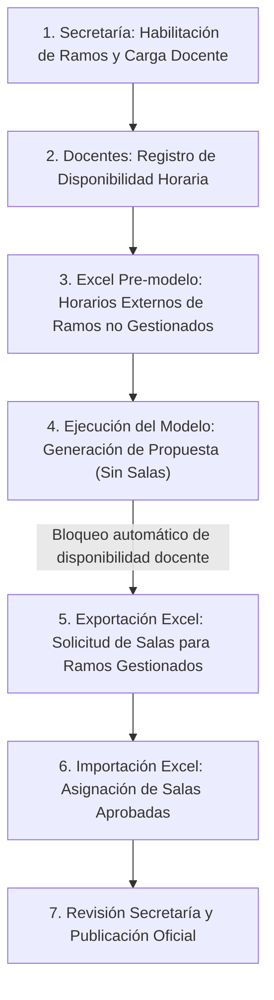

# Sistema Web para la Optimización de Horarios Académicos

> **Proyecto de Título** — Ingeniería Civil en Informática  
> *Universidad del Bío-Bío (UBB)*

[](https://www.typescriptlang.org/)
[](https://nodejs.org/)
[](https://expressjs.com/)
[](https://www.postgresql.org/)
[](https://orm.drizzle.team/)
[](https://pnpm.io/)

Administración: [reinicio de ofertas y horarios, y estados del período](docs/administracion-periodos.md).

---

## 📌 Descripción del Proyecto

Aplicación web integral para apoyar la planificación de horarios semestrales en carreras universitarias, con enfoque aplicado al contexto de Ingeniería Civil en Informática de la UBB y su coordinación académica.

El sistema aborda un problema combinatorio de alta complejidad (*Timetabling Problem*) mediante un flujo que combina gestión académica, disponibilidad docente, intercambio de planillas Excel y, como objetivo del proyecto, un motor de optimización matemática que considere disponibilidad docente, capacidades de salas, topes de asignaturas y cargas horarias.

> Este repositorio corresponde a un prototipo de Proyecto de Título. No está pensado como plataforma institucional productiva general, sino como una implementación funcional y reproducible para el contexto académico definido.

---

## 🔄 Flujo Operativo Principal



1. **Gestión Académica**: la secretaría habilita la oferta de asignaturas del semestre y asigna la carga de cada docente dentro del alcance de su carrera.
2. **Disponibilidad Docente**: los profesores ingresan sus bloques de disponibilidad mientras el semestre está en fase de recepción.
3. **Horarios Externos Pre-modelo**: la importación Excel incorpora ofertas y horarios de departamentos externos antes del modelo; quedan sin sala y sin publicar.
4. **Optimización Automática**: el motor asigna bloques horarios minimizando choques de asignaturas y respetando preferencias docentes. Al existir horarios generados, la disponibilidad docente queda bloqueada.
5. **Solicitud de Infraestructura**: se exporta la propuesta a Excel para que la unidad central de aulas asigne salas.
6. **Carga de Salas Aprobadas**: se importa la planilla de respuesta para asociar cada bloque con su sala definitiva.
7. **Ajuste y Publicación Oficial**: la secretaría ajusta lo necesario y publica el horario para consulta de la comunidad universitaria.

---

## 🛠️ Stack Tecnológico

| Capa | Tecnología | Descripción |
| :--- | :--- | :--- |
| **Backend** | **Node.js + Express + TypeScript** | API REST estructurada con arquitectura limpia en capas y tipado estricto. |
| **Base de Datos** | **PostgreSQL** | Motor relacional robusto y ACID para persistencia de datos. |
| **ORM / DAL** | **Drizzle ORM + Drizzle Kit** | Tipado TypeScript nativo de extremo a extremo y control de migraciones. |
| **Validación** | **Zod** | Validación de esquemas y DTOs en tiempo de ejecución con mensajes en español. |
| **Frontend** | **React + TypeScript** *(en desarrollo)* | Interfaz para secretaría y docentes sobre la API existente. |
| **Package Manager** | **pnpm** | Gestión estricta y eficiente de dependencias. |

---

## 🏛️ Arquitectura del Backend

El backend sigue los principios de **Clean Architecture** con separación estricta de responsabilidades en capas:

```text
backend/src/
├── config/          # Variables de entorno validadas con Zod y cliente DB
├── controllers/     # Manejo de peticiones y respuestas HTTP
├── db/
│   ├── schema/      # Definición de tablas y relaciones con Drizzle ORM
│   ├── migrations/  # Migraciones SQL generadas por Drizzle Kit
│   ├── seeds/       # Datos base y módulos de carga del seed
│   └── seed.ts      # Entrypoint del seed
├── middlewares/     # Manejador global de errores y validación Zod
├── repositories/    # Capa de acceso a datos (consultas SQL y transacciones)
├── routes/          # Definición y mapeo de endpoints REST
├── services/        # Lógica de negocio, reglas de dominio y errores tipados
├── utils/           # Helpers puros, manejo de errores y constantes
└── validations/     # Esquemas Zod para validación de DTOs y parámetros
```

---

## 🧭 Alcance por Carrera y Departamento

El sistema modela el alcance operativo de secretaría desde la carrera asociada al usuario:

```text
usuarios → secretarias.usuario_id → secretarias.carrera_id
```

La relación `carrera_departamento` indica que un departamento presta servicios a una carrera, y `es_gestionado` distingue si ese departamento es gestionado operativamente por la carrera.

| Concepto | Significado |
| :--- | :--- |
| Fila en `carrera_departamento` | El departamento presta servicios a la carrera. |
| `es_gestionado = true` | La secretaría gestiona ramos, profesores, disponibilidad y accesos de ese departamento. |
| `es_gestionado = false` | Presta servicios, pero sus horarios se coordinan como externos y sus accesos no los administra la secretaría. |

En reglas de dominio, **alcance** son todos los departamentos relacionados con la carrera y **gestión** son solo los marcados con `es_gestionado=true`. Los profesores se clasifican en `planta` y `part time`.

Departamentos gestionados inicialmente para el prototipo:

- Sistemas de Información
- Economía y Finanzas
- Administración y Auditoría

Este modelo separa tres necesidades: vistas de secretaría limitadas a su carrera, exportación Excel de salas para ramos gestionados e importación Excel pre-modelo para horarios de ramos externos.

### Importación de horarios externos

`POST /api/horarios-asignaturas/excel/externos/importar?planificacionSemestreId=…&departamentoId=…`
recibe un archivo `.xlsx` en el campo multipart `archivo` (máximo 10 MB), con el formato común de una hoja y los encabezados definidos en `backend/src/utils/excel-horarios-externos.ts`.

- El archivo contiene la carga completa del departamento, incluso asignaturas de otras carreras. Se seleccionan por código únicamente las asignaturas ya registradas en la malla de la carrera de la planificación y pertenecientes al departamento externo elegido. No se requiere columna `Carrera` ni se crean asignaturas.
- Las filas con códigos no coincidentes se ignoran antes de validar sus demás datos. Una fila no vacía sin código es un error. Un archivo sin ofertas pertinentes no modifica ni vacía la carga anterior.
- El archivo reemplaza las ofertas y horarios de ese departamento en esa planificación: actualiza las secciones existentes conservando sus identificadores, crea las nuevas y elimina las secciones ausentes, incluso las de asignaturas omitidas del archivo. No modifica otros departamentos ni planificaciones.
- Solo se permite importar en la planificación actual en preparación. Toda la carga se valida antes de escribir y se aplica en una transacción; cualquier error conserva el estado anterior. El profesor debe estar registrado en el departamento y se identifica por RUT. Las columnas `Sala N` se ignoran.
- Los errores de filas pertinentes incluyen `fila`, `columna`, `mensaje`, `codigoAsignatura`, `nombreAsignatura` y `valor`. Los errores generales del archivo no necesariamente tienen una asignatura asociada.
- La validación avanza por etapas para todo el archivo: primero resuelve los RUT de los profesores; después valida secciones y cupos; finalmente revisa sesiones, conflictos y cobertura. Si falla una etapa, devuelve sus errores sin avanzar a la siguiente ni guardar datos. El formato y los códigos se comprueban antes de estas etapas; las filas de otras carreras se siguen ignorando antes de validar sus RUT.
- La respuesta exitosa incluye `ofertasCreadas`, `ofertasActualizadas`, `ofertasEliminadas`, `horariosCreados` y `asignaturasCargadas` (código, nombre, semestre de malla y secciones). `horariosCreados` cuenta los bloques guardados tras reemplazar los anteriores. Reimportar el mismo archivo no duplica ofertas ni bloques.

La consulta visual de cobertura por semestre de malla queda pendiente para la página de importación. El importador acepta ofertas de ambas paridades; no rechaza asignaturas por su semestre de malla ni exige que el archivo cubra toda la paridad del período.

---

## 🌱 Datos del Prototipo

El proyecto mantiene un **seed único**, no separado entre `base` y `dev`, porque el despliegue corresponde a un prototipo con datos controlados.

```bash
cd backend
pnpm run db:seed
```

El seed no ejecuta `TRUNCATE` ni borra datos existentes: asegura catálogos académicos, bloques horarios, salas, departamentos, profesores y usuarios iniciales. Su fuente es `OptimizacionHorarios_v3.xlsx` y los datos académicos viven en `backend/src/db/seeds/data/`.

Incluye 49 asignaturas de los semestres de malla 1 al 10, con tipos de hora y cantidades del Excel en bloques académicos de 40 minutos. No incluye Electivos I–VI ni Formación Integral Oferta Institucional; sí conserva las prácticas y el proyecto de título con cero horas. Gestión Estratégica (612239) pertenece al semestre 7 y a Administración y Auditoría, al igual que Gestión Presupuestaria y Financiera (610229).

Incluye diez departamentos y 46 profesores con departamento confirmado: 38 `planta` y ocho `part time` (Sting Parra, Jazna Meza, Oscar San Martin, Valeria Beratto, Mauricio Fuenzalida, Ariel Andia, Erick Contreras y Freddy Banda). Cristian Pinto pertenece a Sistemas de Información, independientemente del departamento de sus asignaturas. Tienen correos sintéticos `@ubb.cl`, RUT ficticios válidos y la contraseña inicial `123456` almacenada mediante hash. Al repetir la carga se conservan IDs y contraseñas existentes. Cada profesor tiene un índice ficticio explícito para generar su RUT sin depender del orden del catálogo; los índices retirados no se reutilizan.

La carga normal se ejecuta en una transacción y actualiza nombre, semestre, departamento y horas positivas de las asignaturas incluidas en la seed, sin reemplazar sus códigos ni modificar sus indicadores de criticidad. No elimina asignaturas ajenas, perfiles existentes, disponibilidades, ofertas ni horarios, y no importa las disponibilidades del Excel. Los profesores de otras carreras marcados `(F)` en los Excel externos no se agregan: sus filas se conservan como casos que el importador debe ignorar por código de asignatura.

Jorge Ruiz (P42) queda fuera de la seed porque ya no tiene secciones en Requerimientos del Excel actualizado; su índice ficticio 21 permanece reservado. Quitar un profesor de estos datos iniciales no elimina su cuenta ni su perfil de una base previamente poblada.

Jaime Alfredo Hernández Moraga y Lilian Viviana Velásquez Zapata se incluyen en Estudios Generales como docentes de Inglés, con afiliación confirmada aunque no figuren en el v3 actualizado. Oscar Alejandro Cornejo Zúñiga (P47), docente de Investigación de Operaciones (430183), se incluye en Ingeniería Industrial. No quedan profesores pendientes de departamento en este catálogo.

Morin Antonia Órdenes Escobar (P31) pertenece a Física e imparte Electromagnetismo (230034); la seed registra su perfil, sin crear asignaciones docentes ni horarios. Ariel Andia se incluye en Sistemas de Información como encargado de prácticas, sin crear horarios para estas.

Gabriel Rodolfo Lagos Aguayo (P35), docente de Sistemas Digitales en el Excel, pertenece al Departamento de Ingeniería Eléctrica y Electrónica (DIEE). Este departamento se vincula a las carreras como externo (`es_gestionado = false`) y utiliza la importación genérica de Excel de horarios externos, sin un importador especial.

> Las credenciales iniciales son parte del contexto del prototipo y no representan una política de seguridad productiva. No deben usarse fuera de un entorno local.

Para reemplazar los datos académicos locales existe `pnpm run db:seed --reemplazar-academico`, que **borra asignaturas, profesores y sus dependencias** dentro de una transacción y solo opera en un entorno de desarrollo local. Antes de usarlo, respaldar la base.

---

## ⏳ Estado del Proyecto

### Implementado

- [x] Backend Express + TypeScript + Drizzle ORM con arquitectura limpia en capas.
- [x] Control de bloqueo de disponibilidad docente al generar propuestas de horario.
- [x] Publicación de horarios por entrada (`semestres_horarios`), con `sala_id` opcional.
- [x] Exportación e importación Excel de asignación de salas.
- [x] Importación Excel pre-modelo de horarios de departamentos externos.
- [x] Alcance carrera-departamento mediante `carrera_departamento.es_gestionado`.
- [x] Seed único no destructivo con datos base del prototipo.
- [x] Validación y normalización de RUT en la API de profesores.

### Pendiente

- [ ] Filtro transversal por secretaría/carrera en vistas y acciones.
- [ ] Integración del solver/modelo de optimización en el backend.
- [ ] Frontend React para secretaría y docentes.

Los contratos de API, formatos de planilla y detalles de migraciones se documentan en el código y en el historial de cambios del repositorio.

---

## 🚀 Puesta en Marcha (Backend)

### Requisitos Previos

- [Node.js](https://nodejs.org/) (v20 o superior; v22 recomendado)
- [pnpm](https://pnpm.io/) (`npm install -g pnpm`)
- [Docker & Docker Compose](https://www.docker.com/)

### Instalación y Ejecución

1. **Iniciar base de datos con Docker**:

   ```bash
   docker compose up -d postgres pgadmin
   ```

2. **Instalar dependencias e iniciar desarrollo**:

   ```bash
   cd backend
   pnpm install
   pnpm dev
   ```

3. **Comandos de base de datos**:

   ```bash
   pnpm run db:generate   # Generar nuevas migraciones SQL
   pnpm run db:migrate    # Aplicar migraciones a PostgreSQL
   pnpm run db:seed       # Asegurar datos base sin borrar datos existentes
   pnpm run db:studio     # Abrir visor web Drizzle Studio
   ```

### Verificación

Desde la raíz del repositorio, mediante Docker:

```powershell
docker compose run --rm --no-deps backend sh -c "pnpm run build && pnpm exec tsc --noEmit && pnpm exec vitest run tests/schema-organization.test.ts tests/departamento-asignaturas.test.ts tests/alcance-secretaria.test.ts"
```

Las suites de integración que ejercitan PostgreSQL requieren `RUN_ISOLATED_DATABASE_TESTS=true` y una base aislada, migrada y sembrada; sin esa habilitación se omiten por seguridad. No ejecutar la suite completa contra una base compartida o con datos importantes.

Para verificar la importación Excel usando una base `horarios_test` separada en el PostgreSQL habitual:

```powershell
powershell -NoProfile -File scripts/probar-excel-externos.ps1
```

Ver [alcance, aislamiento y resultados de la prueba](docs/pruebas-excel-externos.md).
